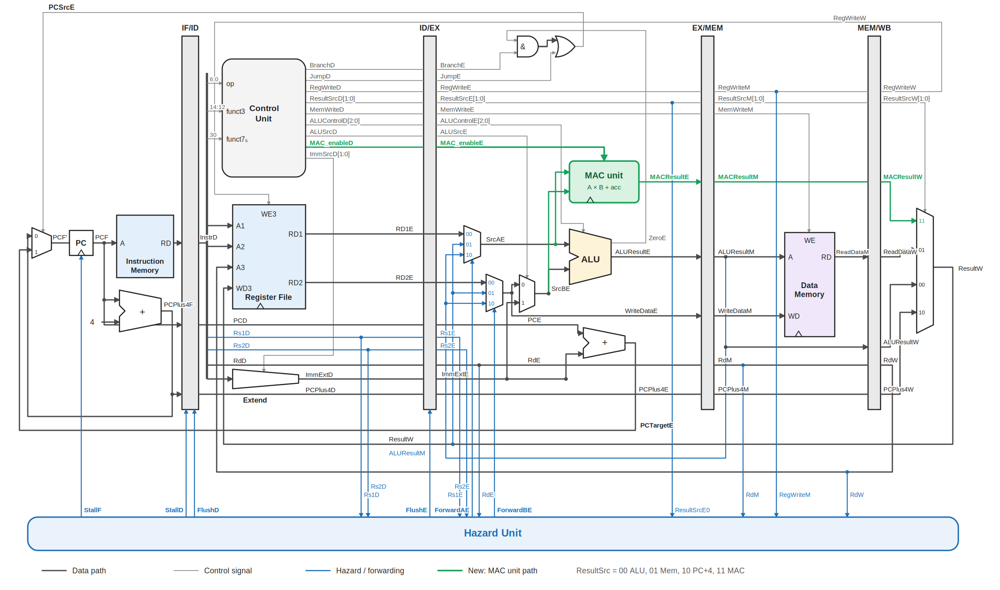

# riscv-custom-mac-processor

# Design and ASIC Implementation of a Timing-Driven, Low-Power 32-bit RISC-V Processor with Custom MAC Unit

## Overview

This project presents the RTL design, functional verification, synthesis, and ASIC physical implementation of a 32-bit, five-stage pipelined RISC-V processor integrated with a custom Multiply-Accumulate (MAC) unit.

The processor extends the base architecture with custom MAC instructions to accelerate arithmetic-intensive operations. Low-power techniques, including operand isolation and integrated clock gating, are employed to reduce unnecessary switching activity.

The design is described in Verilog HDL and evaluated using synthesis, timing, power, and physical design reports.

## Key Features

- 32-bit RISC-V processor with a five-stage pipeline
- Instruction Fetch (IF), Instruction Decode (ID), Execute (EX), Memory Access (MEM), and Write Back (WB) stages
- Custom Multiply-Accumulate (MAC) instruction extension
- 32-bit multiplication with a 64-bit accumulation result
- MAC, MACLO, MACHI, and CLR custom operations
- Data forwarding and hazard detection
- Pipeline stalling and flushing
- Operand isolation and clock-gating-based low-power optimization
- RTL functional verification using testbenches
- Timing-driven synthesis and ASIC physical implementation

## Custom MAC Unit

The custom MAC unit performs multiplication and accumulation:

**Accumulator_new = Accumulator_old + (A × B)**

It uses the RISC-V Custom-0 opcode and the funct3 field to distinguish the supported operations.

| Instruction | Function |
|---|---|
| MAC | Multiply two operands and accumulate the product |
| MACLO | Read the lower 32 bits of the accumulator |
| MACHI | Read the upper 32 bits of the accumulator |
| CLR | Clear the 64-bit accumulator |

The MAC unit is integrated into the processor execution datapath, with the relevant control signals and results propagated through the pipeline.

## Processor Architecture

The processor uses a five-stage pipeline:

1. **Instruction Fetch:** Fetches instructions using the program counter.
2. **Instruction Decode:** Decodes instructions, reads registers, and generates control signals.
3. **Execute:** Performs ALU operations, evaluates branches, and executes MAC operations.
4. **Memory Access:** Handles load and store operations.
5. **Write Back:** Writes the selected execution, memory, or MAC result to the register file.

Pipeline registers maintain data and control information between stages.

### Hazard Handling

The design includes mechanisms to maintain correct instruction execution in a pipelined environment:

- Data forwarding to resolve register dependencies.
- Load-use hazard detection and pipeline stalling.
- Pipeline flushing to handle control-flow changes.
- Control-signal propagation for custom MAC operations.

## Low-Power Optimization Techniques

The proposed processor incorporates two low-power optimization techniques to reduce unnecessary switching activity.

### 1. Operand Isolation

Operand isolation is implemented in the custom MAC unit to reduce unnecessary switching activity in the combinational multiplier.

When a MAC operation is enabled, the input operands are passed to the multiplier. When the MAC operation is inactive, the multiplier inputs are clamped to zero, preventing unnecessary input transitions from propagating through the multiplier logic.

### 2. Integrated Clock Gating

Clock gating targets unnecessary clock transitions in sequential logic. The MAC accumulator uses enable-controlled updates, allowing the synthesis flow to insert integrated clock-gating cells where supported by the configuration and target library.

### Evaluation

The effectiveness of these techniques is assessed by comparing baseline and optimized implementations using area, power, and timing reports.

## Tools and Technologies

- **HDL:** Verilog
- **Functional Simulation:** ModelSim / QuestaSim
- **Synthesis:** Cadence Genus
- **Physical Design:** Cadence Innovus
- **Technology:** 90 nm CMOS standard-cell library
- **Design Frequency Target:** 100 MHz
- **Analysis:** Static Timing Analysis (STA), power analysis, and Design Rule Check (DRC)

## ASIC Implementation Flow

The design follows an RTL-to-GDSII-oriented implementation flow:

1. RTL design and functional verification
2. Logic synthesis and technology mapping
3. Timing-driven floorplanning
4. Power distribution network generation
5. Standard-cell placement
6. Clock Tree Synthesis (CTS)
7. Global and detailed routing
8. Parasitic extraction and post-route timing analysis
9. Power, performance, area (PPA) evaluation and DRC verification

## Results

The dissertation reports the following comparison between baseline and low-power optimized implementations.

| Metric | Baseline | Optimized |
|---|---:|---:|
| Total cell area | 120,470.47 µm² | 112,950.67 µm² |
| Total power | 7.43 mW | 2.40 mW |
| Area reduction | — | 6.24% |
| Power reduction | — | 67.69% |

The reported setup slack was 192 ps before Clock Tree Synthesis and 8 ps after routing. The dissertation also reports zero DRC violations.

These figures are reported results from the project and depend on the stated implementation environment and constraints.

## Verification

Functional verification covers the processor datapath and custom MAC operations. The testbench exercises supported arithmetic and logic instructions, memory operations, branches, jumps, and MAC-related instructions.

Simulation waveforms are used to examine instruction progression, pipeline behavior, MAC results, and hazard-control signals.

## Repository Contents

This repository contains the Verilog RTL modules and testbench files for the processor.

Refer to the source files to explore the processor datapath, control logic, pipeline registers, hazard-handling logic, and custom MAC implementation.

## Future Scope

- Expand instruction-level and regression testing.
- Improve verification coverage and automated test generation.
- Explore further timing and power optimization.
- Evaluate additional microarchitectural improvements.

## Author

**Sreelakshmi A R**

M.Tech — VLSI Design

Vellore Institute of Technology, Chennai

## Disclaimer

This repository is intended for educational and research purposes. Tool-dependent implementation results may vary with technology libraries, design constraints, and synthesis and physical design configurations.

